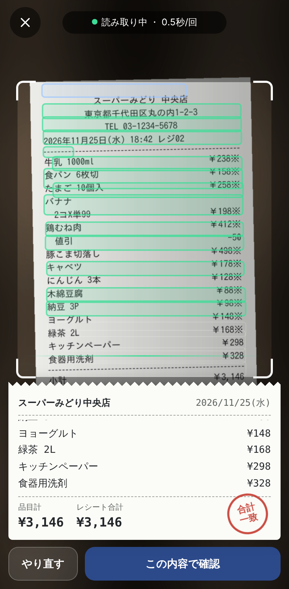
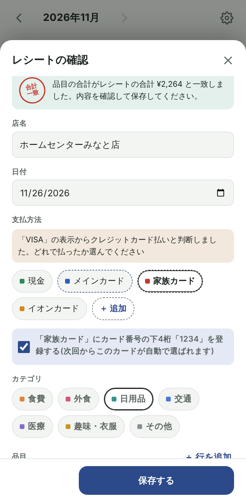
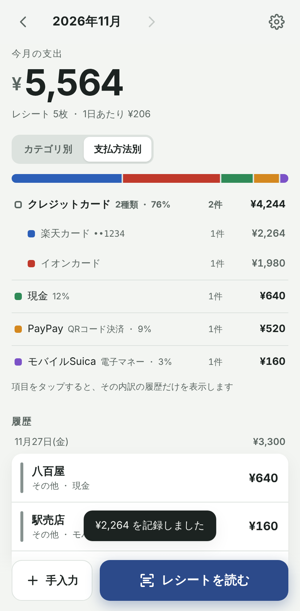

# レシート家計簿

レシートにスマホのカメラを向けるだけで、映像から文字をリアルタイムに読み取って品目と金額を記録する家計簿です。写真を撮る操作はありません。ブラウザで動く PWA なので、iPhone でも Android でも使えます。

| 読み取り中 | 確認 | 支払方法別のまとめ |
|---|---|---|
|  |  |  |

## できること

- **ライブ読み取り**: カメラ映像を 0.5〜1 秒ごとに文字認識し、認識した行を枠で表示します。読み取った品目は画面下の「感熱紙テープ」に印字されていきます。
- **長いレシートにも対応**: レシートを上から下へ動かすと、フレームごとの結果をつなぎ合わせます。同じ行が 2 回以上見えたら確定(黒字)、1 回だけなら仮(灰色の「?」)です。
- **合計の照合**: 「品目計」と、レシートの「合計」行(外税のときは品目計+外税)を照らし合わせます。一致すると判子が押され、端末が振動します。
- **読み違いの自動補正**: 合計と合わないとき、1 か所だけ直せば一致する読み方を探します(別フレームで読めた金額、0↔9 のような数字の取り違えなど)。答えが 1 つに決まる場合だけ採用し、補正した行は色付きで示します。
- **自動で埋まる項目**: 店名、日付、支払い方法(現金・クレジット・電子マネー・QR 決済)、カテゴリ(店名から推定)。
- **家計簿**: 月ごとの合計、カテゴリ別・支払方法別の内訳、日付ごとの履歴、手入力、編集・削除。

## 支払方法

現金、クレジットカード(1枚ずつ)、デビットカード、電子マネー、QR コード決済、口座振替、ポイント・商品券などを登録して、記録ごとに選べます。

- **登録**: 右上の歯車 →「支払方法を登録・編集」。種類・名前・色を決めます。カードはブランドと下4桁も登録できます。電子マネーと QR 決済は、よく使われる名前(モバイルSuica、PayPay など)をタップで入力できます。
- **読み取り時の自動選択**: レシートに印字された支払いの情報から、登録済みの支払方法を選びます。
  1. カード番号の下4桁(「************1234」)が登録済みのカードと一致すれば、そのカード
  2. 「PayPay」「Suica」などのサービス名が登録名に含まれていれば、その支払方法
  3. 「VISA」などのブランドが1枚だけと一致すれば、そのカード
  4. 種類(クレジット・電子マネー・現金など)に当てはまる支払方法が1つだけなら、それ
- **決めきれないとき**: 同じ種類のカードが複数あるときは、候補を点線で示して選んでもらいます(選ぶまで保存できません)。レシートに下4桁が載っていれば、選んだカードにその下4桁を登録するチェック欄が出ます。次回からはそのカードが自動で選ばれます。
- **まとめ**: ホームの「支払方法別」タブで、種類ごとの合計と、カード1枚ごとの内訳を表示します。項目をタップすると、その支払方法の履歴だけに絞り込めます。
- **使わなくなった支払方法**: 「選択肢に表示しない」にすると、過去の記録とまとめはそのまま残り、記録のときの選択肢からは消えます(記録のある支払方法は削除できません)。
- **書き出し**: CSV に「支払方法」「支払方法の種類」の列があります。JSON バックアップには支払方法の登録も含まれます。
- **データ**: 端末内(localStorage)に保存します。CSV 書き出し、JSON バックアップと復元に対応しています。画像や記録が外部に送られることはありません。
- **オフライン**: 文字認識エンジン(Tesseract.js)と日本語モデルを同梱しています。一度開けば電波がなくても動きます。

## スマホで使うには(https での公開が必要)

ブラウザは、https で配信されたページでしかカメラを使わせません。このフォルダをそのまま静的サイトとして公開してください。ビルドは不要です。

### GitHub Pages(無料)

1. GitHub で新しいリポジトリを作り、このフォルダの中身をすべて push します。
2. リポジトリの **Settings → Pages** で、Source を「Deploy from a branch」、Branch を `main` / `(root)` にして保存します。
3. 数分後に表示される `https://<ユーザー名>.github.io/<リポジトリ名>/` をスマホで開きます。

### Netlify Drop(アカウント登録だけで使える)

<https://app.netlify.com/drop> を開き、このフォルダをドラッグ&ドロップします。https の URL がすぐに発行されます。

### ホーム画面に追加

- iPhone(Safari): 共有ボタン →「ホーム画面に追加」
- Android(Chrome): メニュー →「アプリをインストール」

### パソコンで試す

```bash
npm start
```

`http://localhost:8080` を開くと、パソコンの Web カメラで試せます(localhost は例外的に https なしでもカメラが使えます)。

## 読み取りのコツ

- 明るい場所で、レシートを平らな机に置きます。
- 枠の**幅いっぱい**にレシートが入る距離まで近づけます(金額の列が枠からはみ出すと読めません)。
- 長いレシートは、上から下へゆっくり動かします。
- 暗いときは、右上のライトボタンを使います(対応端末のみ)。

## しくみ

```
カメラ映像 ─▶ ガイド枠を切り出し(幅960px)
          ─▶ 手ブレしたフレームを捨てる(ラプラシアン分散)
          ─▶ 照明ムラを除去(局所平均で割り算、机などの背景は白で塗る)
          ─▶ Tesseract.js(日本語 LSTM、Web Worker 内)
          ─▶ 行ごとに分類: 品目 / 値引 / 小計 / 合計 / 税 / 支払い / 日付 / 店名
          ─▶ フレーム間で統合(品名の類似度+金額で対応付け、得票で確定)
          ─▶ 合計と照合、必要なら 1 か所だけ補正
```

| ファイル | 役割 |
|---|---|
| `index.html` / `style.css` | 画面 |
| `js/app.js` | 家計簿の画面、保存、編集、書き出し |
| `js/scanner.js` | カメラ、フレームの取り込み、OCR の連続実行、枠の描画 |
| `js/preprocess.js` | 画像の前処理(照明ムラ除去、ブレ判定) |
| `js/parser.js` | レシートの文字列解析、フレーム統合、合計照合、支払方法の手がかり抽出(DOM 非依存) |
| `js/payments.js` | 支払方法の種類、旧データの移行、登録済み支払方法の推定、支払方法別の集計(DOM 非依存) |
| `sw.js` / `manifest.webmanifest` | オフライン対応とホーム画面アプリ化 |
| `vendor/tesseract/` | Tesseract.js v7.0.0、LSTM 版コア、日本語モデル(best_int) |
| `test/parser.test.js` | 解析ロジックのテスト(`npm test`) |

## 精度について

合成したレシートの映像(15 品目、照明ムラとぼけあり)でのテストでは、読み取り開始から約 8 秒で全品目の金額と合計が一致しました。ただし Tesseract の日本語認識には限界があります。

- 品名の細かい誤字(「たまご」が「たまこご」など)は残ることがあります。金額と合計の照合を優先した設計です。
- 印字が薄れた感熱紙、しわの強いレシート、文字の小さい 80mm 幅のレシートは精度が下がります。
- 店名がロゴ画像だけのレシートは、店名を読み取れません(確認画面で入力してください)。

さらに精度を上げたい場合は、次の方法があります。

1. **ネイティブアプリ化**: iOS の Vision(`DataScannerViewController`)や Android の ML Kit Text Recognition(日本語対応)を使うと、認識精度と速度が大きく上がります。`js/parser.js` の解析ロジックはそのまま移植できます。
2. **確定時だけ AI で清書**: 読み取りはこのまま端末内で行い、「確定」を押したときだけ最も鮮明なフレームを画像認識 AI に送って品名を整えます(API キーを置くサーバーが必要です)。

## ライセンス

- このアプリのコード: MIT
- Tesseract.js / tesseract.js-core: Apache License 2.0(`vendor/tesseract/LICENSE-*`)
- 日本語学習データ(tessdata_best): Apache License 2.0
